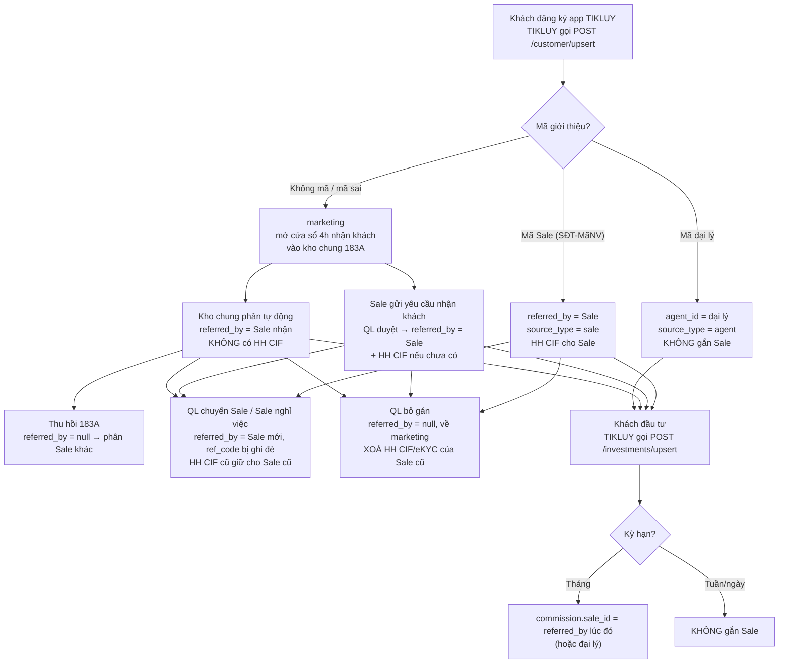
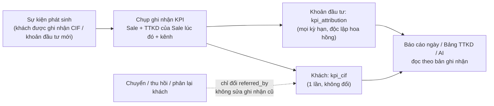

# Chốt luồng: ghi nhận khách, báo cáo ngày & đánh giá TTKD (TIKLUY)

> Trạng thái: **ĐÃ CHỐT LUỒNG (12/11/2026)** — 13 câu ở mục 8. **API đã làm xong (nhánh `feat/crm-daily-report`, 12/11/2026)** — xem mục 11.
> Web chưa làm. Còn chờ **dữ liệu đầu vào** ở mục 9 trước khi đưa lên.
> Đi kèm: `CRM-DAILY-SALES-REPORT-PLAN.md` (kế hoạch tổng), `CRM-CUSTOMER-CARE-SLA-PLAN.md` (Quy định 183A — kho chung, phân khách).
> Phạm vi: chỉ TIKLUY. Hiện trạng đọc từ code nhánh `main` ngày 12/11/2026.

## 1. Yêu cầu cần đạt

1. Sale nhập báo cáo ngày: kế hoạch đầu ngày, kết quả cuối ngày; số hệ thống đã có thì tự lấy, chỉ nhập phần chưa có.
2. Lãnh đạo xem hằng ngày theo mẫu KPI: thực hiện ngày, lũy kế tháng, lũy kế năm, % hoàn thành, số còn thiếu.
3. Phân biệt và đánh giá được **từng TTKD (HN1, HN2…) và từng chi nhánh**.
4. (Giai đoạn sau) Lãnh đạo hỏi AI để xem báo cáo linh hoạt.

**Điều kiện nền**: mỗi con số (CIF, doanh số đầu tư) phải xác định chắc chắn **thuộc Sale nào, TTKD nào, tại thời điểm nào**,
và **không bị thay đổi về sau** khi khách được chuyển/thu hồi. Hệ thống hiện tại chưa đáp ứng điều này (mục 3).

## 2. Luồng ghi nhận khách hiện tại



| # | Tình huống | Code | Ghi gì vào khách / khoản đầu tư |
|---|---|---|---|
| 1 | Đăng ký có mã Sale `SĐT-MãNV` | `CustomerController.upsert` | `referred_by` = Sale, `source_type=sale`, HH CIF (`cif_commission`) cho Sale; eKYC cùng lúc → HH eKYC |
| 2 | Đăng ký có mã đại lý | như trên | `agent_id`, `source_type=agent`, không gắn Sale |
| 3 | Không mã / mã sai | như trên | `marketing`, `claim_window_until` (4 giờ làm việc), vào kho chung 183A |
| 4 | Nhập mã giới thiệu sau đăng ký | `applyReferral` | **Đã tắt** (trả 410) |
| 5 | Yêu cầu nhận khách được duyệt / bị thu hồi | `CustomerClaimRequestController` | `referred_by` = Sale, HH CIF/eKYC nếu chưa có / thu hồi thì xoá HH của Sale đó |
| 6 | Kho chung phân tự động / thu hồi (183A) | `workflows/customer-care` (`setCustomerOwner`) | `referred_by` = Sale nhận / `null`; **không** HH CIF |
| 7 | QL gán thủ công | `assignCustomer` | `referred_by` = Sale; chỉ đổi `source_type=sale` khi QL xác nhận "do Sale giới thiệu"; **gán ngược** các khoản đầu tư cũ chưa có Sale cho Sale mới |
| 8 | QL chuyển Sale / Sale nghỉ việc | `reassignCustomer`, `reassign-sale-customers` | `referred_by` = Sale mới, `ref_code` bị ghi đè; HH cũ giữ cho Sale cũ |
| 9 | QL bỏ gán | `unassignSale` | `referred_by=null`, về `marketing`, **xoá HH CIF/eKYC** của Sale cũ |
| 10 | Khách đầu tư | `InvestmentController.upsert` | Kỳ hạn tháng: `commission.sale_id` = `referred_by` lúc đó (hoặc đại lý). **Kỳ hạn tuần/ngày: không gắn Sale** |

## 3. Vấn đề khi dùng luồng hiện tại để tính KPI

| # | Vấn đề | Hậu quả với báo cáo |
|---|---|---|
| 1 | `referred_by` là "người **đang** giữ khách", đổi khi chuyển/thu hồi/phân lại | CIF tháng trước có thể "chạy" sang Sale/TTKD khác → số quá khứ thay đổi |
| 2 | `ref_code` bị ghi đè khi chuyển Sale | Mất dấu ai giới thiệu khách ban đầu |
| 3 | HH CIF bị xoá khi bỏ gán; QL gán có xác nhận "do Sale giới thiệu" không tạo HH CIF | Không dùng thẳng HH CIF làm KPI được |
| 4 | Đầu tư kỳ hạn tuần/ngày không gắn Sale | Doanh số đầu tư của Sale bị thiếu |
| 5 | QL gán thủ công gán ngược khoản đầu tư cũ cho Sale mới | Doanh số tháng đã qua bị đổi chủ |
| 6 | Khách của đại lý/CTV không gắn Sale/TTKD | Doanh số kênh đại lý không thuộc TTKD nào |
| 7 | Không lưu TTKD tại thời điểm phát sinh | Sale chuyển TTKD giữa kỳ → số cũ chuyển theo |
| 8 | Không có nơi ghi KH quan tâm (chưa đăng ký) theo SĐT | Không đo được hiệu quả tiếp cận/roadshow |
| 9 | TIKLUY chưa gửi tất toán/tái tục | Chưa tính được NET, tỷ lệ tái tục |

## 4. Quy tắc ghi nhận đã chốt

**Nguyên tắc**: tách 2 khái niệm.

- **Người đang chăm sóc** = `referred_by` — giữ nguyên như hiện tại (phục vụ 183A, phân quyền, hoa hồng).
- **Ghi nhận KPI** = bản chụp **bất biến** tại thời điểm phát sinh: Sale nào, TTKD nào, qua kênh nào. Chuyển/thu hồi khách về sau
  **không sửa** bản ghi nhận cũ; chỉ sự kiện **mới** (khoản đầu tư mới) mới ghi cho người đang giữ.



### R1. CIF (Q1, Q2)

| Kênh | Có tính CIF? | Ghi cho | Ngày tính |
|---|---|---|---|
| Đăng ký bằng mã Sale | Có | Sale có mã | Ngày đăng ký |
| Yêu cầu nhận khách được duyệt | Có | Sale gửi yêu cầu | Ngày duyệt |
| QL gán **có** xác nhận "do Sale giới thiệu" | Có | Sale được gán | Ngày gán |
| Đăng ký bằng mã đại lý/CTV | Có (kênh "đại lý") | **Sale phụ trách đại lý** tại thời điểm đăng ký (R4) | Ngày đăng ký |
| Kho chung 183A phân tự động | Không | — | — |
| QL gán **không** xác nhận nguồn, chuyển Sale, Sale nghỉ việc | Không (CIF cũ giữ nguyên cho người đã được ghi nhận) | — | — |
| QL **bỏ gán** / thu hồi yêu cầu nhận khách đã duyệt | **Huỷ** ghi nhận CIF nếu đang thuộc Sale đó (đây là thao tác sửa sai, giống cách HH CIF bị xoá) | — | — |

Ghi vào khách: `kpi_cif = {sale_id, department_id, agent_id, channel, at}` — ghi 1 lần, chỉ huỷ ở dòng cuối bảng trên.

### R2. Doanh số đầu tư (Q3, Q12)

- Mỗi khoản đầu tư **khi tạo** ghi `kpi_attribution = {sale_id, department_id, agent_id, channel}`:
  - Khách đang có Sale (`referred_by`) → Sale đó, **mọi kỳ hạn** (tháng/tuần/ngày), không phụ thuộc hoa hồng.
  - Khách không có Sale nhưng có đại lý → Sale phụ trách đại lý lúc đó (kênh "đại lý").
  - Không có cả hai → **Chưa phân bổ**.
- Không đổi về sau: QL gán thủ công vẫn gán ngược **hoa hồng** như hiện tại, nhưng **không** sửa ghi nhận KPI của khoản cũ.
- Giá trị = **tiền vào (gross)**: tổng `amount` khoản mới, trừ khoản bị huỷ. NET + tỷ lệ tái tục thêm khi TIKLUY gửi sự kiện tất toán/tái tục.

### R3. Đơn vị (Q6, Q7)

- `department_id` trong mọi bản ghi nhận và phiếu báo cáo = **TTKD của Sale tại thời điểm phát sinh** → điều chuyển nhân sự không làm đổi số cũ.
- Sale thuộc nhiều phòng ban → lấy phòng ban loại TTKD được xếp sớm nhất (không có TTKD thì phòng ban đầu tiên).
  Nên xếp mỗi Sale đúng 1 TTKD — `scripts/surveyKpiOrgAssignment.ts` liệt kê Sale thuộc nhiều phòng ban.

### R4. Đại lý / CTV (Q4)

- Mỗi đại lý/CTV được gán **1 Sale phụ trách** (màn Đại lý trên web). CIF và doanh số qua đại lý tính cho Sale đó + TTKD của Sale, kênh "đại lý" để lọc riêng.
- Đại lý **chưa gán Sale** → số vào dòng "Chưa phân bổ — kênh đại lý". Gán Sale cho đại lý **trước khi chạy backfill** để dữ liệu cũ vào đúng TTKD.

### R5. Chưa phân bổ (Q5)

- Khách/doanh số không có Sale hiện ở dòng **"Chưa phân bổ"** cấp công ty → tổng các TTKD + dòng này = tổng công ty.

### R6. Dữ liệu cũ (backfill, chạy 1 lần khi đưa lên)

- CIF: lấy theo HH CIF hiện có (`cif_commission.sale_id`, `granted_at`) + khách đại lý theo Sale phụ trách đại lý; TTKD = TTKD hiện tại của Sale.
- Đầu tư: `commission.sale_id`; trống thì `referred_by` hiện tại; trống nữa thì Sale phụ trách đại lý; còn lại "Chưa phân bổ".
- Sai số chấp nhận được với khách đã chuyển Sale trước ngày đưa lên — ghi chú trên báo cáo "số trước ngày dd/mm tính theo dữ liệu hiện có".

## 5. Luồng báo cáo ngày của Sale (Q8, Q9, Q10)

- **Ai phải nộp**: Sale có kế hoạch KPI năm, từ ngày hiệu lực của kế hoạch (pilot 4 người trước). Sale chưa có kế hoạch vẫn được tính số tự động vào TTKD.
- **Ngày phải nộp**: **thứ Hai → thứ Bảy**; trừ Chủ nhật, ngày lễ, ngày nghỉ có đơn được duyệt.
- **Giờ**: kế hoạch trước **09:30**, kết quả trước **17:30**; nhắc lúc 08:45 và 16:30.
- **Sau 17:30**: báo cáo đã nộp bị **khoá sửa**; chưa nộp thì vẫn nộp được đến 23:59 nhưng ghi **"trễ"**; sau ngày đó = **"thiếu"**.
  Luồng QL duyệt điều chỉnh sau chốt làm ở giai đoạn sau.

```mermaid
sequenceDiagram
    participant S as Sale
    participant V as vWork
    participant Q as Quản lý / Lãnh đạo
    V->>S: 08:45 nhắc nộp kế hoạch (nếu chưa nộp)
    S->>V: Kế hoạch ngày: mục tiêu từng chỉ tiêu + ghi chú (hạn 09:30)
    Note over V: Trong ngày tự cộng theo bản ghi nhận: đầu tư, CIF, KH mới có giao dịch, cuộc gọi OMICall ≥ 20 giây
    V->>S: 16:30 nhắc nộp kết quả
    S->>V: Kết quả: số nhập tay (merchant, CTV, cuộc hẹn, roadshow…) + kết quả nổi bật, khó khăn, đề xuất (hạn 17:30)
    Note over V: 17:30 khoá báo cáo đã nộp; chưa nộp → trễ, qua ngày → thiếu
    V->>Q: Bảng tổng hợp theo cây đơn vị: ai đã nộp / trễ / thiếu + số ngày, lũy kế tháng, năm
```

## 6. Luồng đánh giá TTKD / chi nhánh (Q7, Q13)

- **Cây 3 cấp trên HRM › Phòng ban**: Khối Chi nhánh & TTKD → **Chi nhánh** (Hà Nội, Hải Phòng, HCM…) → **TTKD** (HN1, HN2…) → Sale.
  TTKD chức năng (Priority, Online 24/7, Phát triển Đối tác) nằm trực thuộc Khối.
- **Loại phòng ban**: Chi nhánh dùng loại **"Khối"** (vì chứa TTKD con, không nhận nhân sự trực tiếp, không phải nộp báo cáo tuần);
  TTKD dùng loại **"Chi nhánh (TTKD)"** (đơn vị lá, nhận Sale) — đổi nhãn thành "Trung tâm kinh doanh (TTKD)".
- Số cộng dồn ở mọi cấp; mỗi cấp hiển thị đúng mẫu KPI (KH kỳ, TH kỳ, % HT kỳ, lũy kế năm, KH năm, % HT năm, % còn phải HT, số còn thiếu)
  + tình hình nộp báo cáo; thêm dòng "Chưa phân bổ".
- **Phạm vi xem theo cây quản lý**: Sale xem của mình; QL TTKD xem TTKD mình; GĐ chi nhánh xem mọi TTKD trong chi nhánh;
  lãnh đạo khối/PTGĐ xem toàn công ty. Dựa trên người phụ trách đơn vị + cây phòng ban, cấp qua màn Phân quyền.

## 7. Danh sách chỉnh sửa CRM

| # | Sửa gì | Ở đâu | Bản 2 ngày? |
|---|---|---|---|
| 1 | Ghi nhận CIF bất biến `kpi_cif` theo R1 | API: `CustomerController.upsert` (đăng ký mã Sale/đại lý), duyệt + thu hồi yêu cầu nhận khách, `assignCustomer` (có xác nhận), `unassignSale` | Có |
| 2 | Ghi nhận đầu tư `kpi_attribution` theo R2 (mọi kỳ hạn) | API: `InvestmentController.upsert`; `assignCustomer` không sửa ghi nhận cũ | Có |
| 3 | Giữ `original_ref_code` khi chuyển Sale | API: `reassignCustomer`, `reassign-sale-customers`, `setCustomerOwner`, `assignCustomer` | Có |
| 4 | Đại lý có Sale phụ trách | API `AgentModel` + endpoint gán; web màn Đại lý | Có |
| 5 | Script backfill ghi nhận dữ liệu cũ (R6) | `scripts/` | Có |
| 6 | Module báo cáo ngày + kế hoạch KPI + bảng tổng hợp theo cây đơn vị | API module mới `daily-report`; web 2 màn | Có |
| 7 | Quyền `daily_report.submit`, `daily_report.view` (toàn công ty / đơn vị mình quản lý gồm cấp dưới / chỉ mình) | Seed quyền + gán qua màn Phân quyền | Có |
| 8 | Đổi nhãn loại phòng ban → "Trung tâm kinh doanh (TTKD)" | Web `DepartmentFormDialog.jsx`, app `hrm/department.js` | Có (nhỏ) |
| 9 | Dựng cây Chi nhánh → TTKD, xếp Sale, gán người phụ trách | Dữ liệu HRM (mục 9) | Có — bạn làm |
| 10 | Biểu đồ doanh số dashboard đọc theo ghi nhận KPI + TTKD | API `getSalesChart` | Sau |
| 11 | Sổ KH quan tâm theo SĐT + phễu (Q11) — cần chốt thêm: khách đăng ký trùng SĐT có tự gán cho Sale không | API + web/app | Sau |
| 12 | QL duyệt điều chỉnh sau chốt sổ | API + web | Sau |
| 13 | TIKLUY gửi sự kiện tất toán/tái tục (NET, tỷ lệ tái tục) | Phía TIKLUY | Sau |

## 8. Bảng quyết định (đã chốt 12/11/2026)

| # | Câu hỏi | Chốt |
|---|---|---|
| Q1 | CIF ghi nhận qua kênh nào? | Chỉ khách Sale tự mang về (mã Sale, yêu cầu nhận khách được duyệt, QL gán có xác nhận "do Sale giới thiệu"); kho chung 183A không tính CIF |
| Q2 | Mốc ngày tính CIF? | Ngày được ghi nhận (đăng ký / duyệt / gán) |
| Q3 | Doanh số đầu tư ghi cho ai? | Sale đang giữ khách lúc đầu tư, mọi kỳ hạn, độc lập hoa hồng |
| Q4 | Khách/doanh số qua đại lý/CTV? | Sale phụ trách đại lý (gán Sale cho từng đại lý) |
| Q5 | Khách chưa có Sale? | Dòng "Chưa phân bổ" cấp công ty |
| Q6 | Sale chuyển TTKD giữa kỳ? | Tính cho TTKD tại thời điểm phát sinh |
| Q7 | Cây đơn vị trên HRM hiện tại? | Chưa có / chưa chắc → dựng mới theo 3 cấp Khối → Chi nhánh → TTKD |
| Q8 | Ai phải nộp báo cáo ngày? | Sale có kế hoạch KPI năm (pilot 4 người trước) |
| Q9 | Giờ nộp, ngày nộp? | Kế hoạch 09:30, kết quả 17:30, thứ Hai → thứ Bảy |
| Q10 | Sau giờ chốt? | Khoá sửa; chưa nộp thì nộp muộn trong ngày, ghi "trễ" |
| Q11 | KH quan tâm theo SĐT? | Làm sau bản 2 ngày |
| Q12 | Đầu tư gross hay NET? | Gross trước; NET khi có dữ liệu tiền ra |
| Q13 | Phạm vi xem? | Theo cây quản lý |

## 9. Dữ liệu đầu vào cần chuẩn bị (chặn việc đưa lên)

| # | Cần | Dùng cho | Ai |
|---|---|---|---|
| 1 | Danh sách **Chi nhánh** và **TTKD** thật (tên, mã), TTKD nào thuộc chi nhánh nào | Dựng cây HRM | Bạn / Ban kế hoạch |
| 2 | **Người phụ trách** từng TTKD và từng chi nhánh | Phạm vi xem theo cây quản lý | Bạn |
| 3 | **Sale TIKLUY → TTKD** (xếp trên HRM, mỗi Sale đúng 1 TTKD) | Gom số theo TTKD | Bạn — soát bằng `scripts/surveyKpiOrgAssignment.ts` |
| 4 | **4 Sale pilot**: mã NV, bộ KPI (TTKD/Priority), KH năm từng chỉ tiêu, ngày bắt đầu báo cáo | Nạp kế hoạch KPI | Ban kế hoạch |
| 5 | **Đại lý/CTV → Sale phụ trách** | R4, backfill | Bạn (có thể sau go-live, trước khi chạy backfill) |
| 6 | Danh sách QL/lãnh đạo cần quyền xem + phạm vi | Gán quyền | Bạn |

## 10. Còn mở (không chặn bản 2 ngày)

- Chỉ tiêu "Gọi vốn" (25%, VNFITE) chưa áp dụng cho TIKLUY: khi tính điểm có trọng số thì chia lại trọng số hay tính 0.
- Định nghĩa chi tiết Merchant sale / Merchant Active / Cuộc hẹn tư vấn / Roadshow (bản 2 ngày cho Sale nhập tay số + ghi chú).
- Q11 bổ sung: khách đăng ký trùng SĐT với KH quan tâm có tự gán cho Sale đã nhập không (ảnh hưởng kho chung 183A).

## 11. Đã triển khai (API) — 12/11/2026, nhánh `feat/crm-daily-report`

### Code

| Phần | File |
|---|---|
| Ghi nhận KPI bất biến (R1–R4) | `src/helpers/kpiAttribution.ts`; field `kpi_cif`, `original_ref_code` (`CustomerModel`), `kpi_attribution` (`InvestmentModel`), `manager_sale_id` (`AgentModel`) |
| Gắn vào luồng cũ | `CustomerController` (`upsert`, `assignCustomer`, `bulkAssignCustomer`, `unassignSale`), `CustomerClaimRequestController` (duyệt / thu hồi), `InvestmentController` (`upsert`, `bulkSync`) |
| Sale phụ trách đại lý | `PATCH /agents/:id/manager-sale` (quyền `agent.assign_sale`); `GET /agents` trả thêm `manager_sale_id` (họ tên, mã NV) |
| Module báo cáo ngày | `src/modules/daily-report/` (model `daily_report`, `kpi_plan`); `src/workflows/daily-report-board.workflow.ts` + `src/workflows/daily-report/auto-metric-sources.ts` |
| Ngày nghỉ cả ngày | `listFullLeaveDays` (module `timesheet`) — miễn báo cáo, không tính tuân thủ |
| Quyền | `daily_report.submit` (SELF), `daily_report.view` (ALL_COMPANY / MANAGED / SELF), `agent.assign_sale`; gán vào `CRM_SALE`, `CRM_SALE_TEAM_LEAD` (xem đơn vị mình quản lý), `CRM_SALE_MANAGER` + `COMPANY_EXECUTIVE` (toàn công ty) |
| Cron | `src/jobs/dailyReportJob.js` — 08:45 nhắc kế hoạch, 16:30 nhắc kết quả, T2–T7 (push `data.type = daily_report_reminder`) |
| Script | `backfillKpiAttribution.ts`, `seedDailyReportKpiPlans.ts` (+ `scripts/data/daily-report-kpi-plans.example.json`), `surveyKpiOrgAssignment.ts` |
| Test | `__tests__/dailyReportDomain.test.ts` (lịch, tiến độ, quy tắc nộp/khoá), `__tests__/dailyReportBoard.workflow.test.ts` (ghi nhận → nộp → tổng hợp theo cây, phạm vi xem, nhắc) |

### API `/daily-reports` (query chung: `date=YYYY-MM-DD` mặc định hôm nay, `app_code` mặc định `tikluy`)

| Endpoint | Quyền | Trả về |
|---|---|---|
| `GET /me` | `daily_report.submit` | Phiếu của tôi: bộ KPI, TTKD, trạng thái nộp, `can_edit_plan` / `can_submit_result`, từng chỉ tiêu `day/mtd/ytd`, `plan_day/plan_month/plan_year`, `pct_*`, `remaining_year`, `suggested_day` (cần đạt hôm nay), nội dung kế hoạch/kết quả |
| `PUT /me/plan` | `daily_report.submit` | Body `{ targets: [{metric_code, value, note}], note }` — chỉ hôm nay, trước 17:30 |
| `PUT /me/result` | `daily_report.submit` | Body `{ values: [{metric_code, value, note}], achievements, blockers, proposals }` — chỉ chỉ tiêu nhập tay; đã nộp thì khoá sau 17:30, chưa nộp thì nộp muộn trong ngày (ghi trễ) |
| `GET /summary` | `daily_report.view` | `units[]` (cây đơn vị có `parent_id`, cộng dồn mọi cấp, kèm dòng "Chưa phân bổ" / "Chưa gán TTKD"), `employees[]`, `totals`, `metrics[]`, `calendar` (số ngày báo cáo đã qua / tổng của tháng, năm để tô màu tiến độ) |

Trạng thái nộp: `on_time`, `late`, `overdue` (chưa nộp, quá hạn, còn trong ngày), `pending`, `missing` (qua ngày), `not_required`.

### Các bước đưa lên (theo thứ tự, làm trên test trước rồi live)

1. Deploy API nhánh `feat/crm-daily-report`.
2. Seed quyền: `npx ts-node --transpile-only scripts/seedPermissionAll.ts`, sau đó **xoá cache quyền Redis** `${BASE_URL}:perm:employee:*`
   (seed ghi thẳng DB, không tự xoá cache — xem `RBAC-SYSTEM-GUIDE.md` mục 5).
3. HRM › Phòng ban: dựng cây Chi nhánh (loại "Khối") → TTKD (loại "Chi nhánh (TTKD)"), xếp Sale, gán người phụ trách; soát bằng
   `npx ts-node --transpile-only scripts/surveyKpiOrgAssignment.ts --app=tikluy`.
4. Gán Sale phụ trách đại lý (`PATCH /agents/:id/manager-sale` — màn web làm ở bước web).
5. Backfill: `npx ts-node --transpile-only scripts/backfillKpiAttribution.ts --app=tikluy --dry-run`, kiểm tra số theo kênh rồi chạy thật.
6. Kế hoạch KPI: sao `scripts/data/daily-report-kpi-plans.example.json`, điền mã NV + KH thật (đơn vị đồng) →
   `npx ts-node --transpile-only scripts/seedDailyReportKpiPlans.ts --file=<file> --app=tikluy --dry-run`, rồi chạy thật.
7. Màn Phân quyền: Sale pilot giữ `CRM_SALE`; QL TTKD `CRM_SALE_TEAM_LEAD`; GĐ chi nhánh / lãnh đạo `CRM_SALE_MANAGER` hoặc `COMPANY_EXECUTIVE`.
   GĐ chi nhánh phải được đặt là **người phụ trách** node chi nhánh để thấy mọi TTKD con (phạm vi "đơn vị mình quản lý").

### Ghi chú khi code (so với thiết kế)

- Số tự động tính trực tiếp lúc xem (chưa có bảng `kpi_daily_fact`) — các hàm tính nằm trong registry `auto-metric-sources.ts`,
  khi làm AI/bảng fact chỉ cần job gọi lại đúng các hàm này.
- CIF "Chưa phân bổ" = khách đăng ký trong kỳ không được ghi nhận cho Sale nào → tổng CIF công ty = tổng số đăng ký.
- Khách đại lý khi đại lý chưa gán Sale có bản ghi nhận CIF với Sale rỗng; bản ghi này **được ghi đè** nếu sau đó khách được ghi nhận
  cho Sale (mã Sale, yêu cầu nhận khách được duyệt, QL gán có xác nhận). Bản ghi đã có Sale thì không đổi.
- Telesale chưa chụp TTKD lúc gọi (call_log không có) → tính theo TTKD hiện tại của Sale.
- Kế hoạch năm/tháng gắn vào TTKD hiện tại của Sale; số thực hiện theo TTKD lúc phát sinh.
- `original_ref_code` chỉ có cho khách đăng ký từ nay — dữ liệu cũ đã bị ghi đè `ref_code` nên không khôi phục được.
- Trên `main` có sẵn test lỗi không liên quan: 6 file `__tests__/kpi*.test.js` import code KPI cũ không còn trên `main`
  (từng nằm ở nhánh `feat/kpi-rollover`…), `approvalChain.test.js` và `requestControllerCreate.test.js` (15 test lỗi cả trên `main` gốc).

### Web — 13/11/2026, nhánh `feat/crm-daily-report` (vWork-website)

| Màn | Route / vị trí | Quyền |
|---|---|---|
| Báo cáo ngày của tôi: bảng KPI mẫu 13 cột (kỳ ngày/tháng) + cột "Cần đạt hôm nay", form kế hoạch, form kết quả (số tự động chỉ xem, số nhập tay, giải trình) | `/bao-cao-ngay` — CRM › Báo cáo & Phân tích | `showDailyReport` |
| Tổng hợp báo cáo ngày: thẻ tóm tắt, cây Khối → Chi nhánh → TTKD → Sale theo kỳ ngày / lũy kế tháng / lũy kế năm, % HT tô màu theo tiến độ thời gian, bấm tên mở bảng mẫu 13 cột + nội dung báo cáo, xuất Excel (sheet "Tổng hợp" + "Báo cáo Sale") | `/tong-hop-bao-cao-ngay` | `showDailyReportMgmt` |
| Cột + nút gán "Sale phụ trách" | Màn Đại lý `/dai-ly` | `agent.assign_sale` |
| Nhãn loại phòng ban "Trung tâm kinh doanh (TTKD)" | HRM › Phòng ban (web + app) | — |

Menu 2 màn báo cáo ngày bị mờ khi chọn công ty VNFITE (chỉ áp dụng TIKLUY). App: mới thêm flag `showDailyReport` / `showDailyReportMgmt`
trong `getPermissions()` (nhánh `feat/crm-daily-report` của vWork, tách từ `feat/crm-customer-care` vì cần `effectivePermissions`).

### Chưa làm

- App: màn báo cáo ngày, ghi nhận thực địa GPS + ảnh.
- AI, KH quan tâm theo SĐT, QL duyệt điều chỉnh sau chốt, biểu đồ doanh số dashboard đọc theo ghi nhận KPI, màn cấu hình KPI / import Excel.
